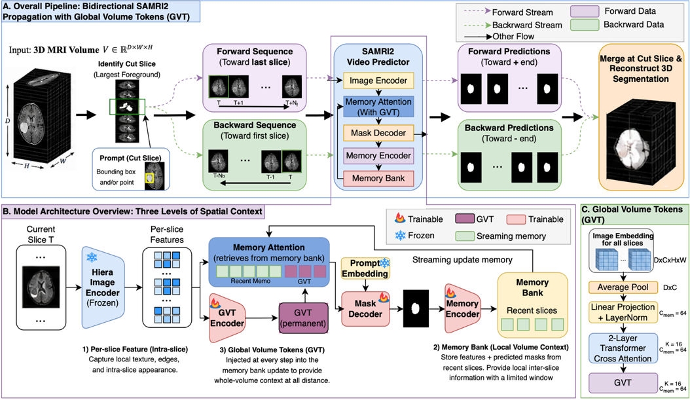
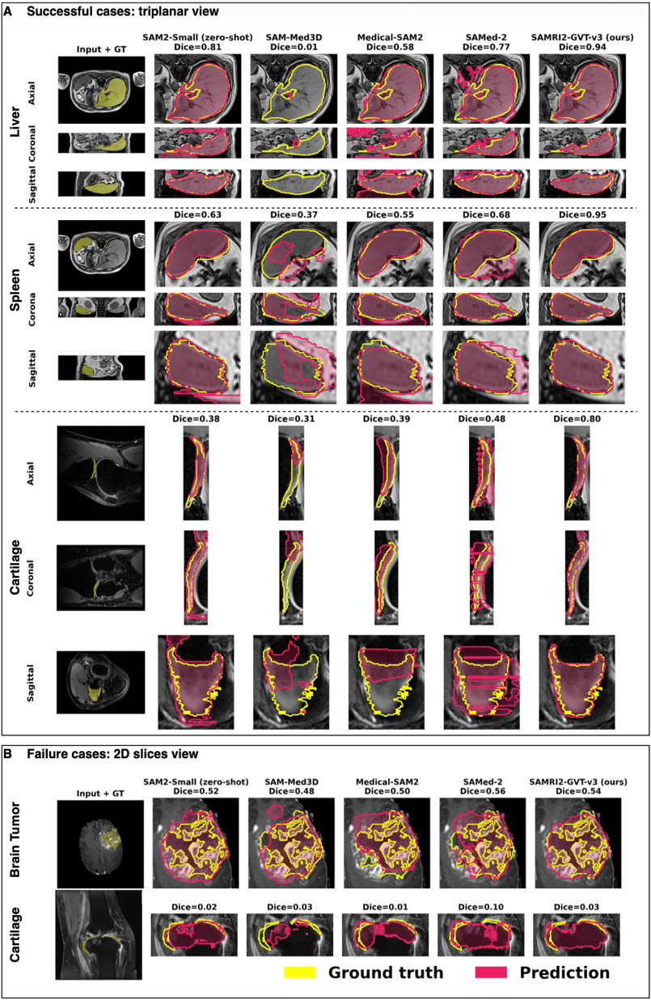

# SAMRI-3D — Segment Anything Model for 3D MRI

Official code for **"SAMRI-3D: Adapting SAM2 for 3D MRI Segmentation with Global Volume
Tokens"** (Wang et al.) — the 3D successor to [SAMRI](https://github.com/wangzhaomxy/SAMRI),
our published 2D MRI model ([arXiv:2510.26635](https://arxiv.org/abs/2510.26635)).

SAMRI-3D adapts Meta's **SAM2** for **3D MRI segmentation**. MRI's low soft-tissue contrast
leaves many boundaries effectively invisible on individual slices, so SAMRI-3D treats a 3D
volume as a bidirectional "video": it is split at the slice with the largest foreground
(the *cut slice*) into two sub-sequences, and SAM2's video predictor propagates the
segmentation outward from a box/point prompt placed on the cut slice. Predictions are
merged back into a 3D semantic mask with the original NIfTI geometry preserved.

Freezing the image encoder and fine-tuning only the lightweight **decoder and memory
modules** raises mean Dice from **0.58** (zero-shot SAM2) to **0.76**. To recover the
boundaries that are invisible slice-by-slice, SAMRI-3D introduces **Global Volume Tokens
(GVT)** — compact, persistent whole-volume memory tokens trained with a **Truncated Signed
Distance Field (TSDF)** shape-prior objective that is *discarded at inference* (zero added
cost). GVT-v3 reaches the best accuracy (**0.78** mean Dice) and generalizes to held-out
datasets with no performance drop.



*Overall SAMRI-3D pipeline. A 3D MRI volume is split at the cut slice (largest foreground)
into forward and backward sub-sequences, each processed by the SAMRI-3D video predictor with
GVT injection, then merged into the full 3D segmentation. Global Volume Tokens summarize the
entire volume and are injected into SAM2's memory bank; a training-only TSDF shape-prior
head supervises them and is discarded at inference.*

> For deep implementation notes and internal design decisions, see [`CLAUDE.md`](CLAUDE.md).

---

## Highlights

- **Decoder-only fine-tuning** on pre-computed SAM2 embeddings (fast, memory-efficient).
- **Unified 2D/3D training** controlled by a single `--mix-ratio-3d` parameter.
- **GVT v1/v2/v3** — global volume tokens, label-conditioned reconstruction, and a TSDF
  shape prior (auxiliary heads are discarded at inference → zero overhead).
- **3D evaluation** with per-label cut slices and Dice / Hausdorff / MSD metrics.
- **Comparison harness** against SAM-Med3D, MedSAM2, Medical-SAM2, SAMed-2, MA-SAM.
- **Publication-quality qualitative figures** (7 visualisation methods, one folder each).

---

## SAMRI-3D-Bench

SAMRI-3D is evaluated on **SAMRI-3D-Bench**, the largest MRI-only SAM2 benchmark to date:
**10,392 volumes** from **34 datasets** (27 public, 7 in-house) spanning **12 anatomical
domains** and **10+ sequences**, with explicit **seen/unseen splits** for zero-shot
generalization testing.

## Key results

Mean Dice over the 34-dataset benchmark (box prompt). Full numbers (HD/MSD, per-domain,
per-sequence, statistical tests) are reported in the paper.

| Model | Type | Mean Dice ↑ |
|-------|------|:-----------:|
| SAM-Med3D | 3D medical SAM | 0.37 |
| Medical-SAM2 | SAM2, medical | 0.49 |
| SAM2 | foundation (zero-shot) | 0.58 |
| SAMed-2 | SAM2, medical | 0.69 |
| **SAMRI-3D** | ours (decoder + memory fine-tune) | **0.76** |
| **SAMRI-3D (GVT-v3)** | ours, best (+ TSDF prior) | **0.78** |

SAMRI-3D (GVT-v3) attains **0.78 ± 0.14 Dice, 13.85 ± 9.01 HD, 2.11 ± 0.96 MSD** and shows
**no drop on held-out datasets** (0.79 unseen vs. 0.78 seen) — per-sequence analysis
confirms the TSDF shape prior helps most where per-slice contrast is weakest.



*Qualitative comparison (triplanar axial/coronal/sagittal views) of SAMRI-3D (GVT-v3) against
zero-shot SAM2-Small, SAM-Med3D, Medical-SAM2, and SAMed-2. Yellow = ground truth,
magenta = prediction. Figures are produced by [`qualitative_study.py`](qualitative_study.py).*

---

## Repository layout

```
SAMRI2/
├── sam2/                       Vendored Meta SAM2 package (model + configs)
├── training/                   SAM2Train backbone (Hydra/DDP training system)
├── comparison/                 Vendored comparison-model code (each needs its own env)
├── gvt/                        Global Volume Token module
│   ├── gvt_module.py           GVTModule, GVTReconDecoder, TSDFDecoder
│   ├── gvt_integration.py      Wraps SAM2 memory_attention with GVT tokens
│   ├── gvt_inference.py        GVT token computation at inference
│   └── train_gvt_emb_tsdf.py   Canonical GVT training (v1/v2/v3)
├── gui/                        Interactive Jupyter GUI (ipywidgets + ipycanvas)
│   ├── samri3d_gui.py           GUI app
│   ├── inference_backend.py    Box/point-prompted bidirectional propagation
│   └── SAMRI3D_GUI.ipynb        Notebook launcher
├── utils/
│   ├── dataloader.py           NiiDataset / Filtered{,3D}NiiDataset
│   ├── losses.py               Dice / Hausdorff / MSD
│   ├── tsdf_utils.py           TSDF computation + boundary-weighted loss
│   └── gen_training_list.py    Build dice-scored training lists
├── generate_3d_embeddings.py   Pre-compute SAM2 embeddings for 3D volumes
├── train_unified_emb.py        Train from embeddings (2D loss) — baseline
├── train_unified_emb_3dloss.py Train from embeddings (2D + 3D volumetric loss)
├── train_unified.py            Train from raw images / training list (2D loss)
├── test_vis3d_multi.py         3D evaluation (per-label cut, metrics)
├── comparison_test.py          Evaluate comparison models on the same test data
├── qualitative_study.py        Render qualitative overlay / 3D figures
├── 3d_inference.py             Batch 3D inference without metrics
├── train_multi_gpus.sh         SLURM launcher for all training modes
└── setup.py
```

---

## Installation

```bash
git clone <repo-url> SAMRI2 && cd SAMRI2
conda create -n samri python=3.10 -y && conda activate samri
pip install -e .          # installs the `samri` package + dependencies (see setup.py)
```

- **SAM2** is vendored under `sam2/` — no separate install.
- **PyTorch** with a CUDA build matching your GPU should be installed separately
  (follow the [official instructions](https://pytorch.org/)).
- **Pretrained SAM2.1 checkpoints** (`sam2.1_hiera_{tiny,small,base_plus,large}.pt`) must
  be downloaded from the [official SAM2 repository](https://github.com/facebookresearch/sam2)
  and placed wherever convenient (passed via `--pretrained-ckpt` / `--ckpt-path`).
- **Comparison models** (`comparison/`) each require their **own conda environment** and
  checkpoints; see `comparison_test.py` for per-model setup.

The model config is referenced as `configs/sam2.1/sam2.1_hiera_s.yaml` (resolved through
the vendored `sam2` package); available variants: `_t` (tiny), `_s` (small), `_b+`
(base+), `_l` (large). SAMRI-3D fine-tunes the **small** backbone by default.

---

## Data format

- Images and masks live in the **same folder**.
- Naming: `*_img_*` for images, `*_gt_*` (or `*_seg_*`) for ground-truth masks.
- Supported formats: `.nii.gz`, `.nii`, `.mha`, `.mhd`, `.nrrd`.
- Test data is auto-detected in `<dataset>/testing/` or scanned directly.
- Masks are multi-label integer volumes; each non-zero id is segmented independently.

**Image normalization (important):** all images are normalized with plain **min-max**
scaling to `uint8 [0, 255]` before SAM2 (which then applies ImageNet normalization
internally). Do **not** use percentile clipping — it breaks train/inference consistency.

---

## Workflow

### 1. Pre-compute 3D embeddings (for embedding-based training)

```bash
python generate_3d_embeddings.py \
  --sam2-config configs/sam2.1/sam2.1_hiera_s.yaml \
  --ckpt-path /path/to/sam2.1_hiera_small.pt \
  --data-paths /path/to/Datasets/ \
  --save-dir /path/to/3D_embeddings/
```

### 2. Train

Five training modes are exposed through `train_multi_gpus.sh` (set `TRAINING_MODE`):

| Mode      | Script                        | Description |
|-----------|-------------------------------|-------------|
| `2d_emb`  | `train_unified_emb.py`        | 2D loss from embeddings — **baseline** |
| `3d_emb`  | `train_unified_emb_3dloss.py` | 2D + 3D volumetric loss from embeddings |
| `2d_img`  | `train_unified.py`            | 2D loss from raw images / training list |
| `gvt_v1`  | `gvt/train_gvt_emb_tsdf.py`   | GVT encoder only |
| `gvt_v2`  | `gvt/train_gvt_emb_tsdf.py`   | GVT + reconstruction loss |
| `gvt_v3`  | `gvt/train_gvt_emb_tsdf.py`   | GVT + reconstruction + **TSDF shape prior** (best) |

```bash
# Edit TRAINING_MODE and paths inside train_multi_gpus.sh, then:
sbatch train_multi_gpus.sh
```

Example direct invocation (GVT v3):

```bash
python gvt/train_gvt_emb_tsdf.py \
  --sam2-config configs/sam2.1/sam2.1_hiera_s.yaml \
  --pretrained-ckpt /path/to/sam2.1_hiera_small.pt \
  --embedding-dir /path/to/3D_embeddings/ \
  --save-path /path/to/checkpoints/ \
  --batch-size 1 --num-epochs 200 --lr 5e-6 \
  --lambda-2d 1.0 --lambda-3d 5.0 --mix-ratio-3d 0.8 --max-slices-per-video 32 \
  --use-gvt --gvt-num-tokens 16 --gvt-num-layers 2 --gvt-num-heads 4 \
  --gvt-recon --gvt-recon-res 32 --lambda-aux 1.0 \
  --use-tsdf --lambda-tsdf 1.0 --tsdf-tau 32.0 --tsdf-alpha 4.0 \
  --use-amp
```

Key knobs: `--mix-ratio-3d` (0=pure 2D slices … 1=pure 3D volumes), `--lambda-2d` /
`--lambda-3d` (segmentation loss weights), `--lambda-aux` / `--lambda-tsdf` (GVT
auxiliary losses).

### 3. Evaluate (Dice / HD / MSD)

```bash
# SAMRI-3D (add --use-gvt for GVT checkpoints; GVT config auto-detected from ckpt)
python test_vis3d_multi.py \
  --sam2-config configs/sam2.1/sam2.1_hiera_s.yaml \
  --ckpt-path /path/to/checkpoint.pth \
  --dataset-path /path/to/test_data/ /path/to/zeroshot_data/ \
  --save-path /path/to/results.pkl \
  --num-workers 12 --use-gvt
```

### 4. Comparison models

Each baseline runs in its **own conda environment**; checkpoints live under
`<weights-dir>/<model>/`.

```bash
python comparison_test.py \
  --model medsam2 \                # sam_med3d | medsam2 | medical_sam2 | samed2 | ma_sam
  --dataset-path /path/to/test_data/ /path/to/zeroshot_data/ \
  --weights-dir /path/to/comparison_ckpt/ \
  --save-path /path/to/results_medsam2.pkl
```

### 5. Qualitative figures

Runs inference once, saves per-case `.nii.gz` under `pred_volumes/`, then renders 7
visualisation methods (each into its own `visN_*` folder): cut slice, triplanar, montage,
MIP, 3D surface, surface-distance heatmap, and FP/FN error volume.

```bash
# Full run (inference + all figures)
python qualitative_study.py \
  --samples-json /path/to/qualitative_samples.json \
  --output-dir /path/to/qualitative/ \
  --models sam2_small sam_med3d medical_sam2 samed2 baseline gvt_v1 gvt_v2 gvt_v3

# Re-render from saved volumes only (no inference); subset models/methods
python qualitative_study.py \
  --from-volumes /path/to/qualitative/pred_volumes \
  --output-dir /path/to/qualitative_v2/ \
  --models sam2_small baseline gvt_v3 --vis-methods vis2 vis5
```

---

## Interactive GUI

For point-and-click segmentation (the 3D analogue of [SAMRI v1's](https://github.com/wangzhaomxy/SAMRI)
ipywidgets demo), a Jupyter GUI is provided under `gui/`:

```bash
conda activate samri          # on a machine with a CUDA GPU
jupyter notebook gui/SAMRI3D_GUI.ipynb     # then "Run all cells"
```

or from any notebook cell:

```python
from gui import launch
app = launch(device="cuda")
```

Workflow: **load a volume → scrub slices → draw a bounding box and/or click +/- points on
one slice → load a SAMRI-3D checkpoint (tick "GVT" for GVT models) → Segment** (SAM2
propagates the prompt through the whole volume) **→ toggle the overlay and save as NIfTI.**
Built with `ipywidgets` + `ipycanvas` (already in `setup.py`); use **Jupyter Notebook**
rather than JupyterLab unless the matching labextensions are installed. The GUI reuses the
exact propagation pipeline from `test_vis3d_multi.py` via `gui/inference_backend.py`.

---

## Model variants

| Name      | Training script               | Notes |
|-----------|-------------------------------|-------|
| Baseline  | `train_unified_emb.py`        | 2D Dice-Focal loss only |
| 2D+3D     | `train_unified_emb_3dloss.py` | adds a per-label volumetric Dice loss |
| GVT v1    | `gvt/train_gvt_emb_tsdf.py`   | global volume tokens in the memory bank |
| GVT v2    | `gvt/train_gvt_emb_tsdf.py`   | + label-conditioned reconstruction loss |
| GVT v3    | `gvt/train_gvt_emb_tsdf.py`   | + TSDF shape-prior loss (recommended) |

All variants fine-tune from the SAM2-Small backbone. GVT auxiliary decoders
(`GVTReconDecoder`, `TSDFDecoder`) are **training-only** and discarded at inference.

---

## Citation

If you use SAMRI-3D or SAMRI-3D-Bench, please cite our paper (citation to be finalized):

```bibtex
@article{wang2026samri3d,
  title   = {SAMRI-3D: Adapting SAM2 for 3D MRI Segmentation with Global Volume Tokens},
  author  = {Wang, Zhao and Dai, Wei and Sun, Hongfu and Engstrom, Craig and Chandra, Shekhar S.},
  year    = {2026}
}
```

Please also cite the 2D predecessor **SAMRI** and Meta's **SAM2**:

```bibtex
@misc{wang2025samri,
  title         = {SAMRI: Segment Any MRI},
  author        = {Zhao Wang and Wei Dai and Thuy Thanh Dao and Steffen Bollmann and Hongfu Sun and Craig Engstrom and Shekhar S. Chandra},
  year          = {2025},
  eprint        = {2510.26635},
  archivePrefix = {arXiv},
  primaryClass  = {eess.IV},
  url           = {https://arxiv.org/abs/2510.26635}
}

@article{ravi2024sam2,
  title   = {SAM 2: Segment Anything in Images and Videos},
  author  = {Ravi, Nikhila and others},
  journal = {arXiv preprint arXiv:2408.00714},
  year    = {2024}
}
```

## Contact

- **Zhao Wang** — zhao.wang1@uq.edu.au
- **Shekhar S. Chandra** — shekhar.chandra@uq.edu.au

School of Electrical Engineering and Computer Science, The University of Queensland.

## Acknowledgements & license

SAMRI-3D builds on Meta AI's [SAM2](https://github.com/facebookresearch/sam2) and the
[MedSAM](https://github.com/bowang-lab/MedSAM) line of open-source medical SAM adaptations,
and was developed with the support of the University of Queensland Research Computing
Centre's **Bunya** supercomputer. We thank the MRI research community for the public
datasets that make up SAMRI-3D-Bench.

The `sam2/` and `training/` directories are vendored from the SAM2 release; `comparison/`
contains third-party model code under their respective licenses. SAMRI-3D code is released
under the **Apache-2.0 License**.
